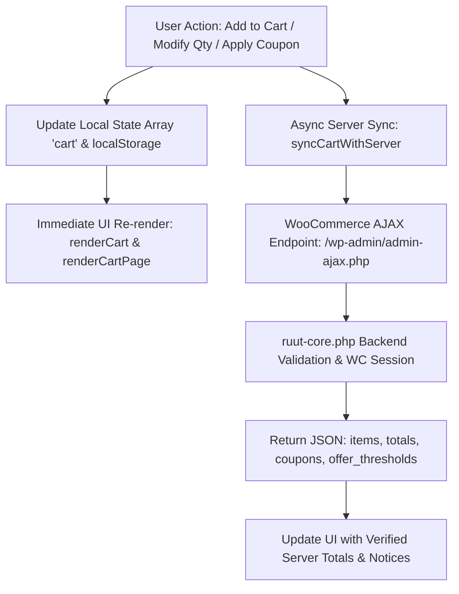

# RUUT E-Commerce Cart & Minicart System Documentation

This document provides a comprehensive specification of the cart system architecture, state synchronization, progressive free gift rules, coupon interactions, element selectors, and execution workflows for both the **Minicart Drawer** and the **Standalone Cart Page ([`cart.html`](file:///c:/Users/RAHUL/OneDrive/Desktop/ruut/cart.html))**.

---

## 1. System Overview & Dual State Storage

The cart system operates on a **hybrid server-local synchronization architecture**:



- **In-Memory & `localStorage`**:
  - `cart`: Array of item objects (`{ id, name, price, originalPrice, quantity, image, volume, sku, key, is_gift }`).
  - Saved under `localStorage` keys: `ruut_cart`, `ruut_coupon`, and `ruut_coupon_savings`.
  - When offline or running local static previews (`file://`), network failures fall back gracefully to `localStorage` calculations.
- **WooCommerce Backend Sync ([`syncCartWithServer`](file:///c:/Users/RAHUL/OneDrive/Desktop/ruut/assets/js/app.js#L460-L539))**:
  - Communicates asynchronously via POST requests to `/wp-admin/admin-ajax.php`.
  - Actions handled in [`ruut-core.php`](file:///c:/Users/RAHUL/OneDrive/Desktop/ruut/wp-content/plugins/ruut-core/ruut-core.php): `ruut_add_to_cart`, `ruut_update_cart_qty`, `ruut_remove_cart_item`, `ruut_apply_coupon`, `ruut_remove_coupon`, `ruut_get_cart`.

---

## 2. Minicart Drawer Architecture (`#astra-mobile-cart-drawer`)

The persistent sliding minicart drawer overlay is available across all website pages except [`cart.html`](file:///c:/Users/RAHUL/OneDrive/Desktop/ruut/cart.html).

### DOM Selectors & Controls

| Element | Selector ID / Class | Purpose |
|---|---|---|
| Drawer Overlay | `#astra-cart-drawer-overlay` | Darkened backdrop overlay |
| Drawer Container | `#astra-mobile-cart-drawer` | Sliding panel container (`.open` class toggles visibility) |
| Cart Icon Badge | `#cartCount` | Header quantity badge counter |
| Item List Container | `#cartItemsList` | Dynamic list wrapper for cart items |
| Progress Bar Wrapper | `#ruut-minicart-progress` | Free gift / volume tier progress bar |
| Progress Fill Bar | `#ruutMinicartFill` | Animated progress bar width percentage |
| Progress Label | `#ruutMinicartText` | Threshold status text label |
| Upsell Recommendation | `#cartUpsellSection` | "Complete The Ritual" sub-category cross-sells |
| Promo Code Input | `#ruut_coupon_code` | Gift / promotional coupon input field |
| Coupon Messages | `#couponMessages` | Coupon validation error / notice box |
| Subtotal Price Display | `#cartSubtotal` | Final calculated subtotal |
| Original Subtotal | `#cartSubtotalOriginal` | Struck-through subtotal before discounts |

### Trigger Functions & Lifecycle

1. **Opening ([`openCart()`](file:///c:/Users/RAHUL/OneDrive/Desktop/ruut/assets/js/app.js#L542-L558))**:
   - Triggered by clicking the header cart icon (`#cartButton`), clicking `.cart-icon`, or executing [`addToCart()`](file:///c:/Users/RAHUL/OneDrive/Desktop/ruut/assets/js/app.js#L1487-L1600).
   - Adds `.open` class to drawer and overlay, setting `document.body.style.overflow = 'hidden'`.
   - Disabled automatically when on [`cart.html`](file:///c:/Users/RAHUL/OneDrive/Desktop/ruut/cart.html).
2. **Closing ([`closeCart()`](file:///c:/Users/RAHUL/OneDrive/Desktop/ruut/assets/js/app.js#L560-L566))**:
   - Triggered by clicking `#closeCartDrawer`, clicking `#astra-cart-drawer-overlay`, or pressing `Escape`.
3. **Rendering Loop ([`renderCart()`](file:///c:/Users/RAHUL/OneDrive/Desktop/ruut/assets/js/app.js#L732-L1178))**:
   - Evaluates free gift rules via [`updateGiftSimulation()`](file:///c:/Users/RAHUL/OneDrive/Desktop/ruut/assets/js/app.js#L628-L729).
   - Recalculates total paid item quantities and updates `#cartCount` with pop animation.
   - Clears and rebuilds `#cartItemsList` HTML.
   - Updates progress dots (`.cart-progress-dot`) and tier milestone text.
   - Generates cross-sell recommendations based on the category of the last added item.
   - Toggles promo input state: if a coupon is active, displays an applied pill (`CODE Applied ✓`) with a remove button (`×`).

---

## 3. Standalone Cart Page Architecture ([`cart.html`](file:///c:/Users/RAHUL/OneDrive/Desktop/ruut/cart.html))

Driven by [`window.renderCartPage()`](file:///c:/Users/RAHUL/OneDrive/Desktop/ruut/assets/js/app.js#L1182-L1442) in [`app.js`](file:///c:/Users/RAHUL/OneDrive/Desktop/ruut/assets/js/app.js), the cart page features a split 70 / 30 layout.

### DOM Selectors & Controls

| Element | Selector ID | Purpose |
|---|---|---|
| Items List Container | `#cartPageItemsList` | Cart item cards container |
| Progress Bar Wrapper | `#ruut-cartpage-progress` | Cart page progress banner |
| Subtotal Value | `#billingSubtotal` | Base subtotal display |
| Rewards Summary Container | `#billingRewardProductsContainer` | List of unlocked free gifts in summary card |
| Detailed Discounts Container | `#billingDiscountsContainer` | Itemized discount breakdown (Sale, Privilege, Volume) |
| Total Value | `#billingTotal` | Final payable total |
| Coupon Input | `#cartpage_coupon_code` | Promo code input field |
| Coupon Applied Remove Btn | `#cartpage_coupon_remove` | Remove active coupon trigger |
| Coupon Messages | `#cartPageCouponMessages` | Error / notice display |
| Suggestions Section | `#cartPageSuggestionsSection` | "Suggested for You" catalog recommendations section |
| Suggestions Grid | `#cartPageSuggestionsGrid` | 3-column recommendations grid |

### Component Sections

#### Left Column (70%):
1. **Progress Banner (`#ruut-cartpage-progress`)**: Displays tier fill bar and milestone text.
2. **Cart Items List (`#cartPageItemsList`)**: Renders item cards containing product image, title, sub-category tag, volume, sensory note ("Feels like..."), regular vs. sale price, quantity selector (`+` / `-`), and remove button.
3. **Unlocked Reward Items**: Items flagged with `is_gift: true` render with a rose border, `"Unlocked Reward"` corner badge, struck-through regular price, and `"FREE"` status.
4. **Suggested for You Grid ([`loadCartPageSuggestions`](file:///c:/Users/RAHUL/OneDrive/Desktop/ruut/assets/js/app.js#L759-L800))**: Pre-fetches the catalog via [`ensureProductsFetched()`](file:///c:/Users/RAHUL/OneDrive/Desktop/ruut/assets/js/app.js#L96), excludes items already in cart, and populates 3 product recommendations with real-time sync.

#### Right Column (30% - Sticky Order Summary):
1. **Subtotal**: Base original price sum of paid items.
2. **Reward Products**: Lists free gift titles with `FREE` status.
3. **Promo Code Input & Explore Link**: Input field + trigger for Privileges Modal overlay (`#ruut-coupons-modal-overlay`).
4. **Detailed Discount Breakdown (`#billingDiscountsContainer`)**:
   - **Product Sale Savings**: Catalog sale discounts (`regular_price - sale_price`).
   - **Privilege Discount**: Savings from active promo coupon code.
   - **Volume Discount**: Savings unlocked from item quantity tiers.
5. **Delivery**: Green `"FREE"` shipping indicator.
6. **Total (`#billingTotal`)**: Final net total after all discounts.
7. **Proceed to Checkout Button**: Link pointing to `/checkout/`.

---

## 4. Smart Engines: Progressive Free Gifts, Volume Discounts & Coupon Stacking Rules

### A. Progressive Free Gift Engine ([`updateGiftSimulation`](file:///c:/Users/RAHUL/OneDrive/Desktop/ruut/assets/js/app.js#L628-L729))
- Evaluates non-gift item quantities (`regularItemsQty`) against store thresholds (`offerThresholds`).
- **Tier Rules**:
  - **Tier 1 (2 items)**: Unlocks compulsory gift (e.g. *Miniature Lavender Mist*).
  - **Tier 2 (3 items)**: Unlocks compulsory gift + random pool gift (e.g. *Tac Hero Air Mist*).
- Resolves gift details (title, thumbnail, volume) from `window.allProducts`. Gifts are assigned `price: 0`, `is_gift: true`, and `key: "gift-local-" + id`.
- Automatically removes gift items if regular item quantity falls below requirements or if a promo coupon is applied.

### B. Volume Tier Discounts ([`getActiveVolumeDiscount`](file:///c:/Users/RAHUL/OneDrive/Desktop/ruut/assets/js/app.js#L415-L435))
- Calculates direct rupee discounts based on regular item counts when no coupon code is active (e.g., ₹100 off for 2 items, ₹250 off for 3 items).

---

### C. Coupon Interaction & Stacking Prevention (CRITICAL)

To prevent **double-dipping / benefit stacking**, applying a promotional coupon code (e.g. `TEST-12`, `TEST-34`) interacts with the progress bar as follows:

```
[User Applies Coupon Code (e.g. TEST-12)]
       │
       ├─► Progress bar rewards (free gifts & volume discounts) are PAUSED.
       ├─► Unlocked free gifts are temporarily REMOVED from cart.
       ├─► Volume tier discount is set to ₹0.00.
       └─► Progress banner displays:
           "Coupon TEST-12 active. (Remove coupon to restore volume discount & free gifts)"

[User Removes Coupon Code (Clicking '×' on Coupon Pill)]
       │
       ├─► activeCoupon becomes empty ("").
       ├─► updateGiftSimulation() instantly RE-INJECTS free gifts (price: FREE).
       ├─► getActiveVolumeDiscount() instantly RESTORES volume tier discount.
       └─► Progress bar dots & unlock status text are FULLY RESTORED.
```

#### Coupon vs. Progress Bar Interaction Matrix:

| State | Active Coupon | Free Gifts in Cart | Volume Tier Discount | Progress Bar Display |
|---|---|---|---|---|
| **No Coupon Active** | None | Unlocked & Added (`₹0.00`) | Active (e.g. ₹100 / ₹250) | Dots & Milestones Active |
| **Coupon Code Active** | `TEST-12` | Temporarily Removed | Paused (`₹0.00`) | Shows Coupon Active Notice |
| **Coupon Removed (`×`)** | Cleared | Automatically Re-added (`₹0.00`) | Automatically Restored | Dots & Milestones Restored |

---

### D. Privilege Coupon Loss Prevention Overlay (`#ruut-confirm-overlay`)

When a user attempts to apply a coupon while another coupon is already active:
1. [`tryApplyCoupon(code)`](file:///c:/Users/RAHUL/OneDrive/Desktop/ruut/assets/js/app.js#L366-L373) checks if `activeCoupon` is set and different from the new code.
2. If active, opens the Loss Prevention Confirmation Modal (`#ruut-confirm-overlay`):
   > *"Applying this privilege will replace your current active privilege, resulting in a lower total benefit. Are you sure you wish to proceed?"*
3. **Cancel**: Keeps the current coupon active.
4. **Apply Anyway**: Calls [`executeApplyCoupon(code)`](file:///c:/Users/RAHUL/OneDrive/Desktop/ruut/assets/js/app.js#L375-L396), replaces the coupon, syncs with WooCommerce server, and triggers confetti popper (`triggerConfetti()`).

---

## 5. Backend WooCommerce Integration ([`ruut-core.php`](file:///c:/Users/RAHUL/OneDrive/Desktop/ruut/wp-content/plugins/ruut-core/ruut-core.php))

All AJAX requests originate from `syncCartWithServer(action, payload)` to `/wp-admin/admin-ajax.php`:

| Action Hook | Backend Callback | Operations Performed |
|---|---|---|
| `wp_ajax_ruut_get_cart` | `ruut_ajax_get_cart()` | Reads `WC()->cart`, returns items, subtotals, applied coupons, and offer thresholds. |
| `wp_ajax_ruut_add_to_cart` | `ruut_ajax_add_to_cart()` | Calls `WC()->cart->add_to_cart($product_id, $quantity)`, returns updated totals. |
| `wp_ajax_ruut_update_cart_qty` | `ruut_ajax_update_cart_qty()` | Calls `WC()->cart->set_quantity($cart_item_key, $quantity)`. |
| `wp_ajax_ruut_remove_cart_item` | `ruut_ajax_remove_cart_item()` | Calls `WC()->cart->remove_cart_item($cart_item_key)`. |
| `wp_ajax_ruut_apply_coupon` | `ruut_ajax_apply_coupon()` | Calls `WC()->cart->apply_coupon($coupon_code)`, validates minimum spend. |
| `wp_ajax_ruut_remove_coupon` | `ruut_ajax_remove_coupon()` | Calls `WC()->cart->remove_coupon($coupon_code)`. |

### Server Response Payload Structure (`response.data`)
```json
{
  "success": true,
  "data": {
    "items": [
      {
        "id": 2489,
        "key": "a87ff679a2f3e71d9181a67b7542122c",
        "name": "Beach Holiday 50ml",
        "price": "1199.00",
        "originalPrice": "1699.00",
        "quantity": 2,
        "image": "http://yourruut.com/wp-content/uploads/2026/06/beach-holiday.webp",
        "volume": "50ml",
        "sku": "SKU-2489",
        "is_gift": false
      }
    ],
    "totals": {
      "subtotal": 2398.00,
      "discount_total": 200.00,
      "volume_discount": 0,
      "total": 2198.00,
      "applied_coupons": ["TEST-12"]
    },
    "offer_enabled": true,
    "offer_thresholds": [
      { "quantity": 2, "discount": 100, "compulsory_gift_id": 101 },
      { "quantity": 3, "discount": 250, "random_gift_id": 2490 }
    ],
    "removed_coupon_message": ""
  }
}
```
