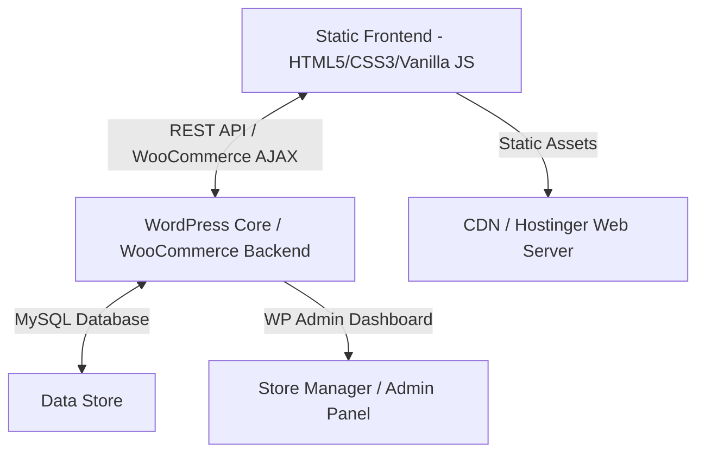

# Architecture Documentation - RUUT E-Commerce System

This document outlines the system architecture, component layout, file registry, and data-flow mechanisms of the RUUT e-commerce website. It serves as an architectural blueprint for future developers and AI agents. For deep-dive cart mechanics, see [`CART_DOCUMENTATION.md`](file:///c:/Users/RAHUL/OneDrive/Desktop/ruut/CART_DOCUMENTATION.md).

---

## 1. System Overview

The RUUT system is built on a **decoupled headless e-commerce architecture**:



- **Frontend**: A high-performance static storefront composed of HTML5, vanilla CSS3 (`styles.css?v=16.0`), and vanilla JavaScript (`app.js?v=110.0`). It is hosted on the web server (Hostinger) and served directly to clients with root-relative routing.
- **Backend**: A headless WordPress instance powered by WooCommerce and the `ruut-core` plugin. It manages products, categories, FAQs, product reels, customer reviews, OTP authentication, address vaults, and cart sessions. It exposes custom REST API endpoints (`/wp-json/ruut/v1/`) and WooCommerce AJAX actions (`/wp-admin/admin-ajax.php`).
- **Data Flow**: The frontend communicates asynchronously via `ruutFetch` and AJAX POST requests to sync shopping carts, apply promotional privileges, render category/product catalogs, handle customer reviews, and trigger checkout sessions.

---

## 2. Frontend Architecture

The frontend is non-compiled, lightweight, and executes entirely client-side.

### Component Directory Structure
```
/
├── index.html                   # Landing homepage template (Hero, Reels, Bestsellers, Story, Reviews, FAQs)
├── shop.html                    # Main product catalog directory (Air Mists, Diffusers, Collections)
├── product.html                 # Dynamic single product detail template (?product=ID)
├── collection.html              # Catalog taxonomy directory page
├── the-atlas-collection.html    # Dedicated Atlas Collection series landing page
├── cart.html                    # Extended cart detail view, order summary & recommendations page
├── about-us.html                # About Us & Founders philosophy page
├── coming-soon.html             # Pre-launch countdown page
├── assets/
│   ├── css/
│   │   ├── fonts.css            # Font face definitions
│   │   ├── coming-soon.css      # Pre-launch page styles
│   │   └── styles.css           # Global stylesheet & design token system (v=16.0)
│   └── js/
│       ├── coming-soon.js       # Pre-launch scripts
│       └── app.js               # Client-side core orchestrator & server cart sync (v=110.0)
```

### Core Interactions

1. **Routing & Clean URLs (`.htaccess`)**: Clean page paths (e.g. `/shop`, `/about-us`, `/cart`) are served seamlessly without displaying `.html` extensions. Deep product page paths like `/shop/airmist/the-atlas-collection/?product=12` are rewritten to `product.html` while preserving URL query parameters.
2. **Logged-In Directing**: An inline script in `<head>` checks for the `wordpress_logged_in_` cookie to direct logged-in users directly to `/shop`.
3. **Cart Synchronization Engine**: A hybrid local-server state manager. Cart mutations (`addToCart`, `updateQty`, `removeCartItem`, `tryApplyCoupon`) immediately update local state and `localStorage`, and asynchronously sync with the WooCommerce session backend via `syncCartWithServer` (`/wp-admin/admin-ajax.php`).
4. **Unified Multi-View Cart Renderer**: `renderCart()` drives the persistent minicart drawer (`#astra-mobile-cart-drawer`), while `window.renderCartPage()` drives the standalone [`cart.html`](file:///c:/Users/RAHUL/OneDrive/Desktop/ruut/cart.html) page. Both draw from shared cart data, volume discounts, progressive gift tiers, and real-time product recommendations (`loadCartPageSuggestions`).

---

## 3. Backend Architecture

The backend consists of the custom WooCommerce plugin `ruut-core` located at [`/wp-content/plugins/ruut-core/ruut-core.php`](file:///c:/Users/RAHUL/OneDrive/Desktop/ruut/wp-content/plugins/ruut-core/ruut-core.php).

```
wp-content/plugins/
└── ruut-core/
    ├── ruut-core.php            # Cart AJAX Sync, Product/Reviews REST APIs, CPTs, OTP auth, Address Book Vault
    └── assets/
        ├── checkout.js          # Checkout OTP & address book overlay scripting
        └── checkout.css         # Styling for customized checkout interface
```

### Key Subsystems

- **WooCommerce Cart AJAX Synchronizer**: Mapped to standard WooCommerce AJAX hooks (`wp_ajax_ruut_*` and `wp_ajax_nopriv_ruut_*`). Processes item additions, quantity changes, item deletions, and coupon applications directly within `WC()->cart`. Returns calculated totals, subtotals, applied coupons, server notices, and progressive offer thresholds.
- **Address Book Vault**: Manages multi-address records for WooCommerce users. Addresses are saved as serialized user meta (`ruut_address_book`) and exposed via REST API (`/wp-json/ruut/v1/address` & `/save-address`).
- **Progressive Offer & Free Gift Engine**: Evaluates item counts against admin-configured thresholds (`offer_thresholds`). Automatically injects compulsory gifts and random pool gifts into the cart with `price: 0`, and calculates volume tier discounts when no promotional coupon is active.
- **Custom Post Types (CPTs)**:
  - **FAQs (`ruut_faq`)**: Exposes `/wp-json/ruut/v1/faqs` for global FAQ accordions.
  - **Product Reels (`ruut_reel`)**: Exposes `/wp-json/ruut/v1/reels`. Manages video MP4 URLs, cover image thumbnails, display ordering, and associated WooCommerce Product IDs (`_reel_product_id`).
  - **Customer Reviews**: Handles reviews via `/wp-json/ruut/v1/reviews`. Submits comments to WooCommerce for admin moderation.
- **The Ruut Story Admin Panel**: Exposes custom WordPress settings fields (Title, Content Editor, Featured Image) in the RUUT admin panel and serves them via `/wp-json/ruut/v1/story`.

---

## 4. Key Data Flows

### A. Dynamic Cart Synchronization Flow
```
User Clicks "ADD TO CART" or Modifies Quantity (Frontend UI)
       │
       ▼
app.js::addToCart() / updateQty() / removeCartItem()
       │
       ├─► Resets cached server totals & updates local `cart` array
       ├─► Triggers immediate local renderCart() & renderCartPage() for instant response
       │
       ▼
app.js::syncCartWithServer(action, payload)
       │
       ▼
POST Request ──► /wp-admin/admin-ajax.php?action=ruut_add_to_cart / ruut_update_cart_qty
                               │
                               ▼
                 ruut-core.php::ruut_ajax_add_to_cart() / ruut_ajax_update_cart_qty()
                               │
                               ├─► WooCommerce: WC()->cart->add_to_cart() / set_quantity()
                               ├─► Calculates subtotals, catalog sale savings & applied coupons
                               ├─► Evaluates progressive gift thresholds & volume discounts
                               │
                               ▼
Response JSON (success: true, items, totals, subtotal, discount_total, coupons, notices)
       │
       ▼
app.js ──► Updates serverSubtotal, serverTotal, serverDiscountTotal, activeCoupon
       │
       ▼
app.js::renderCart() & window.renderCartPage() ──► Updates minicart drawer, cart.html order summary,
                                                     progress bar dots, and recommendations grid
```

### B. Suggested Products Flow on Cart Page (`cart.html`)
```
DOMContentLoaded or Cart Mutation Event
       │
       ▼
app.js::loadCartPageSuggestions()
       │
       ▼
app.js::ensureProductsFetched() ──► GET /wp-json/ruut/v1/products?limit=100
                                          │
                                          ▼
                         Returns WooCommerce catalog array
       │
       ▼
Filters catalog products: Excludes any product ID present in active `cart` array
       │
       ▼
Renders top 3 matching products in #cartPageSuggestionsGrid with ADD + buttons
```

### C. Product Reels & 3D Cover Flow Gallery Modal Flow
```
DOMContentLoaded Event (Landing Page)
       │
       ▼
Fetch GET Request ──► /wp-json/ruut/v1/reels
                               │
                               ▼
                 ruut-core.php::ruut_get_reels_api()
                               │
                               ├─► Queries publish `ruut_reel` CPT ordered by `_reel_order`
                               ├─► Resolves associated WooCommerce Product ID (`_reel_product_id`)
                               │
                               ▼
Response Array (id, title, video_url, thumbnail, order, product details)
       │
       ▼
Frontend ──► Renders horizontal scrolling track (#reelsTrack) with play hover overlays
       │
       ▼
User Clicks Reel Card ──► Opens 3D Cover Flow Gallery Modal (#reelsModal)
                               │
                               ├─► Computes 3D CSS perspective transforms (scale, rotateY, translateZ)
                               ├─► Highlights active video card with golden-orange glowing border (#cf6400)
                               ├─► Plays active video, pauses inactive videos
                               └─► Displays associated WooCommerce product link card below active video
```

### D. OTP Authentication Flow
```
User Enters Mobile/Email (Frontend Checkout / My Account)
       │
       ▼
checkout.js / app.js ──► REST API: POST /wp-json/ruut/v1/send-otp
                               │
                               ▼
                   ruut-core.php::ruut_api_send_otp()
                               │
                               ├─► Generates secure 4-digit code
                               ├─► Saves transient: `ruut_otp_{username}` (5 min expiration)
                               ├─► Dispatches email notification (wp_mail)
                               │
                               ▼
Response (Success status, OTP dispatched)
       │
       ▼
User Inputs 4-Digit Code ──► REST API: POST /wp-json/ruut/v1/verify-otp
                               │
                               ▼
                   ruut-core.php::ruut_api_verify_otp()
                               │
                               ├─► Validates code against stored transient
                               ├─► If existing user: logs in via wp_set_current_user() & wp_set_auth_cookie()
                               ├─► If new user: registers user, fires WooCommerce customer hooks, logs in
                               │
                               ▼
Response (Success, Auth cookie set, profile details returned)
```

---

## 5. Security & CORS Architecture

1. **Origin Verification**: Intercepts REST and AJAX requests, checking client `Origin` headers against allowed domains.
2. **Access Control Headers**: Appends `Access-Control-Allow-Origin`, `Access-Control-Allow-Credentials: true`, and standard request headers.
3. **Session Integrity**: Merges native WooCommerce cookie authentication with AJAX requests to ensure secure cart and checkout state persistence.
